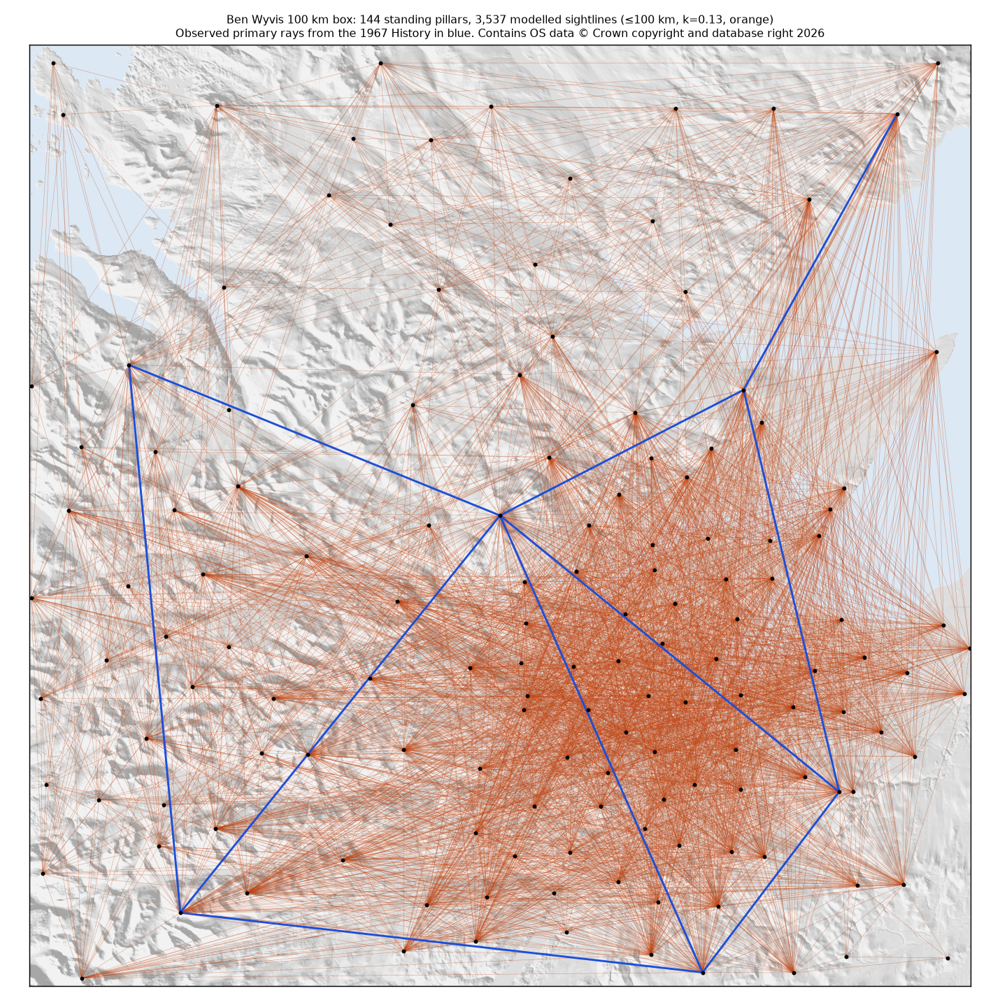
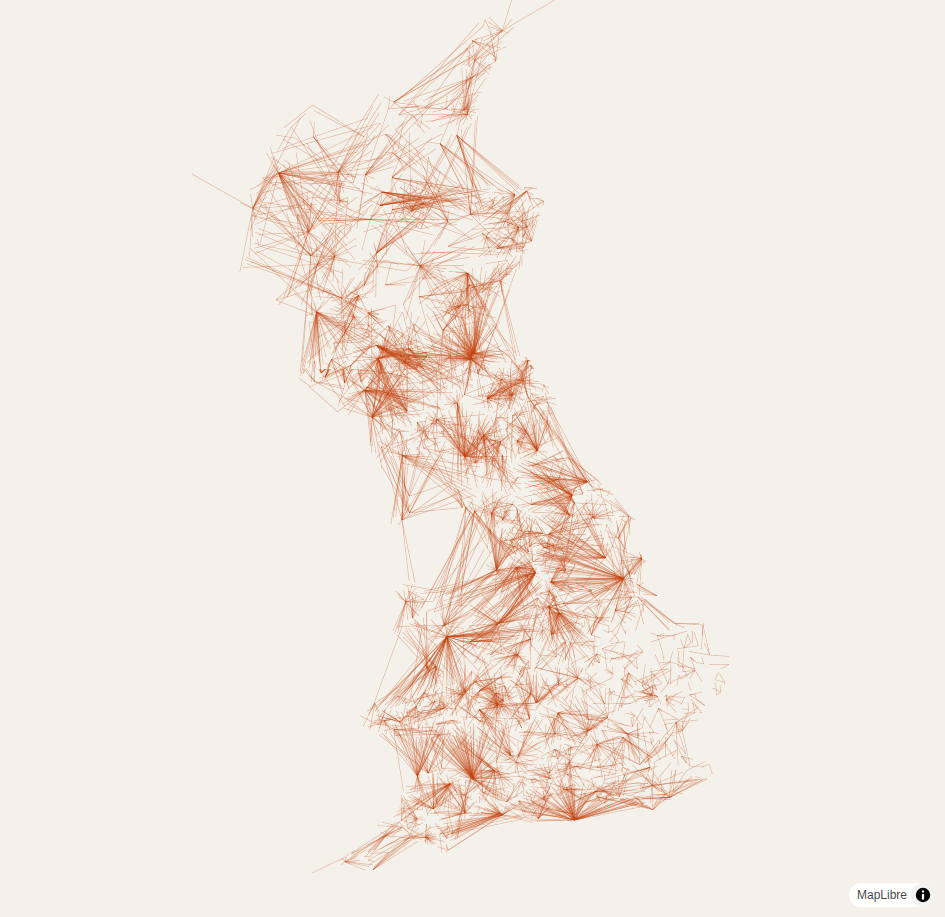
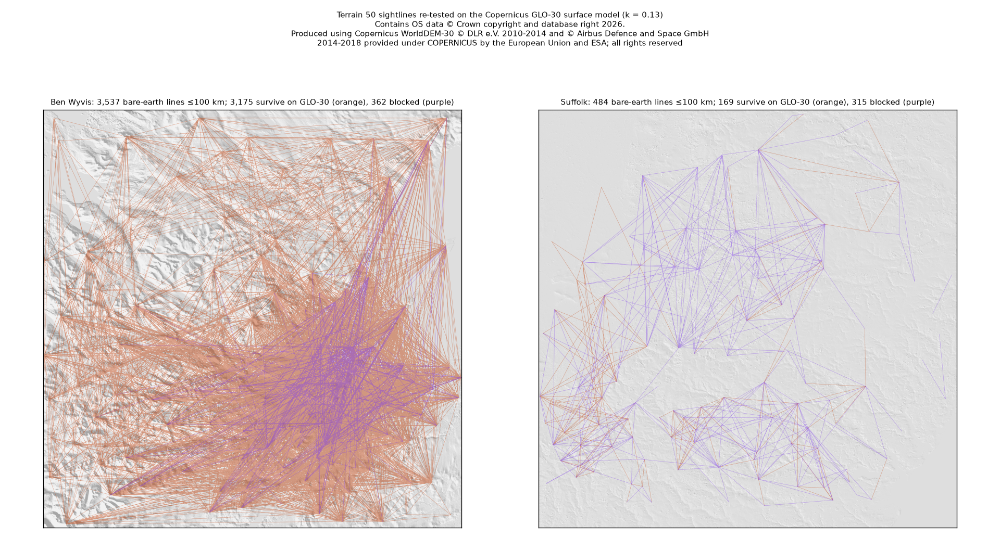

**Verdict: GO.** No public tool or map computes trig-pillar intervisibility for Great Britain. Every viability
question the plan set passed its pre-registered threshold. The model recovers 95.5% of the 641 pillar-to-pillar rays the
1936 to 1962 surveyors actually observed, and 98.9% outside the steel-tower lowlands. The full GB run takes about an hour
of CPU and fits in R2's free tier.

# Retriangulation Redrawn: investigation report

- Variant: `retriangulation-redrawn/sightlines`, investigated on 2026-10-20.
- Plan, written before the analysis: [`docs/investigation-plan.md`](docs/investigation-plan.md).
- Every number below comes from a script in `scripts/` with a saved output in `results/`, or from a cited page.
- Downloaded data lives in `data/` and is gitignored. It can be rebuilt from the URLs given here.

**Caveats that sit alongside the GO.** None of them is a blocker.
- The recall pass is narrow, at 95.5% against a 95.0% threshold.
- Precision is unmeasured. Nobody knows how many of the extra modelled lines can really be seen today.
- The audience signal is modest.

## 1. Verdict

**GO.** The plan's rule was "GO if the gate passes and questions 1 to 6 pass". All seven checks passed.

| Check | Result |
|---|---|
| Gate | No DIRECT equivalent |
| Q1 pillar data | 6,079 standing pillars, OGL |
| Q2 terrain | OS Terrain 50 is OpenData |
| Q3 ground truth | 641 rays plus 68 hand-read rays |
| Q4 LOS accuracy | 95.5% recall at defaults, against a 95% bar |
| Q5 compute | About 1 CPU-hour for all GB at 150 km, against a 12 h bar |
| Q6 tiles and hosting | 117 MB PMTiles renders in MapLibre; £0 a month on R2 |

The one-sentence reason: the idea is unclaimed, and every data, licence and compute piece needed for a static MVP
exists and has been exercised end to end.

## 2. Competition

The full log of 39 searches is in [`results/prior-art-log.md`](results/prior-art-log.md). Three of those were
unreachable or inconclusive: Reddit (403), Bluesky (403) and Mastodon (empty without login).

| Finding | Class | URL | Differentiation |
|---|---|---|---|
| *History of the Retriangulation of GB 1935-1962* (OS 1967): Diagrams 2 and 5 to 11 and the Appendix 1 to 7 direction tables | PARTIAL | https://www.ordnancesurvey.co.uk/documents/resources/history-retriangulation-great-britain-1935-1962.pdf | Static record of the primary rays actually observed. It does not compute terrain visibility and does not cover the lower-order pillars. It is this project's ground truth, not a competitor. |
| Trig Tools primary-rays image (Barry Hunter, 2004) | PARTIAL | https://deformedweb.co.uk/trigs/primary_triangulation.html | One static image of the historical primary rays, marked research-only and not to be redistributed. No computation. |
| ArachnaDude/trig-pillar-project (GitHub, 2023) | PARTIAL | https://github.com/ArachnaDude/trig-pillar-project | Same aim, but abandoned after one month at a horizon-distance formula, with no terrain model and no output. |
| TNA OS 51/16 and Cambridge UL 1957 "primary observations" sheet | PARTIAL | https://discovery.nationalarchives.gov.uk/details/r/C11669498 | Archive paper copies of the same historical diagram. Not online. |
| HeyWhatsThat | PARTIAL | https://www.heywhatsthat.com/faq.html | Viewshed from one viewer on SRTM at about 90 m. It has no notion of trig pillars and builds no network. |
| alltheviews.world | ADJACENT | https://alltheviews.world/faq | Longest line of sight from anywhere on Earth (SRTM about 100 m). It does not answer which survey pillars see which. |
| PeakFinder, PeakVisor, Ulrich Deuschle, Viewfinder Panoramas | ADJACENT | https://www.udeuschle.de/help_01_en.htm | Panoramas from one point, labelling summits. Not a pillar network. |
| QGIS Viewshed Analysis and LoS Tools plugins | ADJACENT | https://landscapearchaeology.org/2020/viewshed-tutorial | Desktop tools that could compute such a network. No published trig output exists. |
| OS "Trig pillars today" cartogram, trigbagging.co.uk, jdconey trig map, OSM_UK_trigpoints, trigpointing.uk | ADJACENT | https://docs.os.uk/more-than-maps/geographic-data-visualisation/geodataviz-assets/how-did-i-make-that/trig-pillars-today | Maps of pillar location and condition. No sightlines. The trigpointing.uk API has no intervisibility field. |
| "Britain's longest view" articles and Walkhighlands threads | ADJACENT | https://www.livefortheoutdoors.com/hiking/long-reads/britains-longest-view/ | Single longest views between summits, not a pillar network. |

## 3. Puzzle pieces

| Piece | Status | Evidence | Effort to close |
|---|---|---|---|
| Pillar data and licence | HAVE | The OS Complete Trig Archive ([zip](https://www.ordnancesurvey.co.uk/documents/gps/CompleteTrigArchive.zip)) has 31,521 records, 7,111 of them PILLAR. 6,079 pillars are not destroyed and 6,816 have a height ([`results/trig_profile.md`](results/trig_profile.md)). The [OS trig page](https://www.ordnancesurvey.co.uk/geodesy-positioning/legacy-data/trig-search) says "available for use under Open Government Licence Terms", the data is "no longer maintained", and archive coordinates are expected to agree with OSTN15 to about 0.10 m r.m.s. | None |
| Current pillar condition | MISSING (optional) | trigpointing.uk holds visitor-reported condition. Its [terms](https://wiki.trigpointing.uk/TrigpointingUK_Wiki:Terms_Of_Use) give reuse rights to site administrators only and promise bulk extracts only "to people who run similar sites". The bulk download needs a login. No reuse licence exists for third parties. | Ask the site owner (outreach, out of scope here), or ship with OS "destroyed" flags only |
| Height datum handling | HAVE | The published height is "the tip of the arrow on this flush bracket" (book p. 16). The pillar rises "4 feet above ground level" (p. 15, Fig. 2.2), and the bracket sits about 0.40 m above ground by scaling Fig. 2.2. The model uses sight height = HEIGHT − 0.40 + 1.219 + 0.25 m (instrument, assumed). For the 87 pillars whose comment says "HT TO TOP OF PILLAR" it uses HEIGHT + 0.25. Datum: 6,640 pillars are on Newlyn (N). The 84 on S and 75 on L are probably the Stornoway and Lerwick local datums ([OS datum list](https://www.ordnancesurvey.co.uk/geodesy-positioning/legacy-data/datum-height-differences)); that mapping is inferred, not confirmed. Archive ground minus DEM at the 244 primary pillars with a positive height has a median of +1.6 m, p10 −0.1 m and p90 +7.7 m ([`results/station_height_vs_dem.csv`](results/station_height_vs_dem.csv)), as expected where a 50 m DEM smooths summits. Using DEM heights instead of the archive drops recall to 91.7%. | Confirm the meaning of the S and L codes (0.5 h) |
| Terrain data and licence | HAVE | OS Terrain 50, version 2026-07, comes as a 154 MB ASCII-grid zip of 2,858 tiles, md5 verified, from the [OS Downloads API](https://api.os.uk/downloads/v1/products/Terrain50/downloads). Licence file: "© Crown copyright and database right 2026", OS OpenData terms (OGL). The GB mosaic builds in 48 s ([`scripts/build_dem.py`](scripts/build_dem.py)). | None |
| Higher-resolution terrain | UNKNOWN | Desk assessment only, nothing downloaded. **EA LiDAR Composite DTM 1 m:** about 99% of England, attribution "© Environment Agency copyright and/or database right 2022"; licence field not confirmed. **Scottish LiDAR:** six phases from 2011 to 2022 with partial coverage; the Phase 3 DTM is OGL, but Phase 2 is a Non-Commercial Government Licence ([spatialdata.gov.scot](https://spatialdata.gov.scot/geonetwork/srv/api/records/f1a18c6d-3f1b-46bb-a5eb-58e5f504c7cb)); Highland coverage not confirmed. **Welsh Government 1 m DTM/DSM 2020-23:** licence inconsistent across [DataMapWales](https://datamap.gov.wales/layers/geonode:welsh_government_lidar_tile_catalogue_2020_2023) records. **Copernicus GLO-30:** a free licence with attribution ([licence PDF](https://documentation.dataspace.copernicus.eu/APIs/SentinelHub/Data/DEM/resources/license/License-COPDEM-30.pdf)); spacedata.copernicus.eu was **unreachable**, and the Copernicus Data Space download needs an account. GLO-30 is a surface model (radar returns from canopy and roofs), so a GLO-30 run would approximate "visible today with trees and buildings" at 30 m. That is coarse but usable as a labelled variant. | 1 evening, once a Copernicus account exists |
| Historical ray ground truth | HAVE | Appendices 1 to 7 of the book list every observed direction. [`scripts/extract_primary_rays.py`](scripts/extract_primary_rays.py) and [`scripts/match_rays.py`](scripts/match_rays.py) found 2,345 direction rows, of which 2,308 matched to first-order stations, giving 1,207 unique pairs. The test set is 641 rays that are pillar to pillar, observed from both ends and at most 120 km. They run from 6.5 to 115 km with a median of 40.7 km; 54 are under 20 km and 105 over 60 km. One parsed pair longer than 120 km (Shurland–Castle Ring, 241 km) is a parse artefact and is excluded. A hand-read set of 68 rays from Diagram 10, covering 13.6 to 67.6 km around Ben Wyvis ([`results/hand_rays_diagram10.csv`](results/hand_rays_diagram10.csv)), was **100% recovered by the parser**. | None for primary rays. Lower-order rays are not in the book: Diagram 20 is an unnamed example block |
| Hours to digitise the primary network | HAVE (done) | Agent estimate: about 2 h of scripting rather than hand digitising, because the appendices carry OCR'd direction tables. | None |
| Book copyright | HAVE | The scan reads "© Crown copyright 1967", HMSO. Under [CDPA 1988 s.163(3)(b)](https://www.legislation.gov.uk/ukpga/1988/48/section/163), Crown copyright in a commercially published work lasts 50 years from the end of the year of publication, so it **expired at the end of 2017**. OS hosts the PDF and a 72 MB diagram zip on its [trig page](https://www.ordnancesurvey.co.uk/geodesy-positioning/legacy-data/trig-search). This is not legal advice. | None |
| LOS accuracy against ground truth | HAVE | Recall at defaults is **95.5%**: 612 of 641 rays ([`results/recall_sweep.csv`](results/recall_sweep.csv)). By figure it is 100% for Figures 1, 2, 3 and 7, 99.1% for Figure 6 (Highlands), 96.7% for Figure 4 (South West and Wales) and 76.5% for Figure 5 (Eastern Counties). Figure 5 "needed steel towers at no fewer than 34 of the primary stations" (book p. 51, §2.130), so its rays were observed from towers, not pillars. Recall excluding Figure-5-only rays is **98.9%** (549 of 555). The hand set scores 98.5% (67 of 68). | Done |
| Refraction sensitivity | HAVE | Recall is 94.9% at k = 0, 95.0% at 0.05, 95.3% at 0.10, 95.5% at 0.13 and 95.8% at 0.20. Within the Ben Wyvis region, visible lines at ≤100 km are 3,470 at k = 0, 3,537 at 0.13 and 3,579 at 0.20, a ±1.2% spread ([`results/region_summary.json`](results/region_summary.json)). Endpoint skip of 0, 50, 100 and 200 m gives 94.9%, 95.3%, 95.5% and 95.6%. | None |
| DEM resolution sensitivity | HAVE (coarsening only) | 50 m gives 95.5%, 100 m gives 95.9% and 200 m gives 96.9%. Coarser grids smooth away obstructions, so a finer DTM would be expected to lower recall slightly, not raise it. Not tested at finer resolution. | See higher-resolution terrain |
| GB-scale compute | HAVE | 6,079 standing pillars give 522,833 pairs within 50 km, 1,756,359 within 100 km and 3,459,140 within 150 km ([`results/gb_extrapolation.json`](results/gb_extrapolation.json)). The full 150 km run took 3,800 s of summed CPU across 8 shards, with 1.5 GB peak RSS per process ([`results/gb_full_run.json`](results/gb_full_run.json)). It is laptop-sized, not overnight-sized. | None |
| Tile size and rendering | HAVE | 229,330 visible lines at ≤150 km. tippecanoe 2.79.0 at z4 to z12 produces a **117.3 MB** PMTiles file with density dropping, or 131.1 MB keeping every line, in 50 s. MapLibre 4.7.1 with pmtiles 3.2.1 rendered both the regional (1.9 MB) and GB tilesets in headless Chromium with no errors ([`results/maplibre_gb_test.json`](results/maplibre_gb_test.json), [`results/maplibre_gb_test.png`](results/maplibre_gb_test.png)). | None |
| Hosting cost | HAVE | Cloudflare Pages caps each asset at 25 MiB, so the 117 MB file must go to R2 ([Pages limits](https://developers.cloudflare.com/pages/platform/limits/)). [R2's free tier](https://developers.cloudflare.com/r2/pricing/) gives 10 GB-month of storage, 10 M Class B reads a month and free egress. That makes it **£0 a month**: 0.13 GB of tiles plus any basemap stays under 10 GB. | None |
| Audience | UNKNOWN (weak signal) | trigpointing.uk reports 7,479 members, 504,604 logs, 742 logs in the last 7 days and 203 users active in the last 30 days ([`results/audience_trigpointing_stats.json`](results/audience_trigpointing_stats.json)). The top trig explainers on YouTube have 547,875 views (The Map Reading Company) and 510,313 (Tom Scott) ([`results/audience_youtube.csv`](results/audience_youtube.csv)). Expressed wishes are one 2021 forum question about which trigs see which, and one abandoned 2023 attempt to build this. Reddit was unreachable. | Out of scope (would need posting) |
| Attribution requirements | HAVE | OS data: "Contains OS data © Crown copyright and database right 2026" ([OS guidance](https://www.ordnancesurvey.co.uk/business-government/licensing-agreements/copyright-acknowledgements)), plus an OGL v3 link. OGL generic wording: "Contains public sector information licensed under the Open Government Licence v3.0." The book is public domain, but credit OS 1967 as good practice. A GLO-30 variant would need the DLR and Airbus attribution plus the liability disclaimer. | None |

## 4. Prototype map and recall

The map shows 144 standing pillars in the 100 km box centred on Ben Wyvis (NG 196296–296296 E, 818378–918378 N). In
orange are the 3,537 lines modelled visible at ≤100 km with k = 0.13. In blue are the 10 observed primary rays with both
ends inside the box. All 10 are recovered at the default settings. The script is
[`scripts/region_prototype.py`](scripts/region_prototype.py), and the run took 2.5 s for 9.7 M profile samples.

Recall on the observed pillar-to-pillar primary rays, at default settings (k = 0.13, flush-bracket heights, 100 m
endpoint skip, 50 m DEM):

| Set | Rays | Recall |
|---|---|---|
| GB, all figures | 641 | **95.5%** |
| GB, excluding Figure 5 (steel towers) | 555 | 98.9% |
| Figure 6 (Highlands, including Ben Wyvis) | 213 | 99.1% |
| Ben Wyvis box, both ends inside | 10 | 100% |
| Hand-read Diagram 10 set around Ben Wyvis | 68 | 98.5% |

**Diagnosis of the 29 misses** ([`results/misses_diagnosis.csv`](results/misses_diagnosis.csv)):
- **23 are Figure 5 lowland rays**, including Crowborough–Ditchling and Shurland–Wrotham. Figure 5 used steel towers at 34 primary stations (book §2.130), so these rays were
  likely observed from tower height, not pillar height. The worst is 10.4 m short at pillar height.
- **4 involve Hensbarrow in Cornwall.** The obstruction is DEM terrain up to 45 m above the sight line, 0.2 to 2 km from
  the pillar. This is consistent with the china-clay workings around Hensbarrow Beacon, which would make it
  a real then-versus-now change rather than a model error. That is inferred from location and not confirmed.
- **Deerness–Fair Isle** is a 92 km sea crossing, 1.7 m short at k = 0.13. Refraction over sea was evidently larger
  than 0.13.
- **Col Bheinn–Scaraben** misses by 0.29 m, 170 m from the station, which is DEM noise at the summit.

Nothing points to a height-datum or systematic DEM fault. Using DEM heights rather than archive heights is worse
(91.7%), which supports the flush-bracket interpretation.

**Extra lines.** In the Ben Wyvis box the model finds 3,537 visible pairs among 144 pillars at ≤100 km, against 10
observed primary rays between the box's few primary stations. Among first-order pillars only, the model finds 23
visible pairs at ≤100 km, of which 10 were observed. Extra lines are expected, because surveyors observed only the
rays they needed. Their *precision*, meaning whether a human could see them today, is unmeasured (see section 6).

GB overview rendered from the full tileset (MapLibre, z5.2; tippecanoe thins lines at low zoom):

## 5. Fit against the owner's constraints

These are agent estimates, at 16 working hours per weekend.

| MVP item | Hours | Basis |
|---|---|---|
| Productionise the pipeline (pillar filter, heights, k, one command) | 4 | Scripts exist and ran end to end today |
| Full GB run, tiling and a "then" layer from the 1,207 parsed primary rays | 3 | About 1 CPU-hour unattended, plus tippecanoe in 50 s |
| Static MapLibre page: click a pillar to highlight its lines and list visible pillars; basemap | 12 | The render test page exists; interaction and basemap are new |
| About and attribution page, QA on mobile, deploy to R2 and Pages | 5 | |
| **Total** | **24 h = 1.5 weekends** | Limit: 1 to 3 weekends. **Fits.** |

| Opex per month | £ | Basis |
|---|---|---|
| R2 storage: 0.13 GB of tiles plus an optional basemap of up to about 1 GB, against 10 GB free | 0 | R2 free tier |
| R2 reads: fewer than 10 M Class B a month, which covers roughly 200,000 visits at 50 tile reads each | 0 | R2 free tier |
| Pages hosting of HTML and JS | 0 | Free plan |
| Optional custom domain, about £10 a year | 0.83 | |
| **Total** | **£0 to £0.83** | Limit: £0 to £20. **Fits.** |

| Weekly upkeep | Hours | Basis |
|---|---|---|
| Data refresh | 0 | The OS archive is frozen ("no longer maintained"), and Terrain 50 updates rarely |
| Hosting | 0 | Static files with no server |
| Occasional bug or feedback | 0.25 | |
| **Total** | **about 0.25 h** | Limit: under 2 to 4 h. **Fits.** |

There are no accounts, ads or content production. The page is a static map.

## 6. Largest remaining unknown and the cheapest experiment

**Unknown: precision.** Are the extra modelled lines actually visible today? The model is a bare-earth terrain model.
Trees, buildings and haze are not in it, so some "visible" lines will be blocked in reality. That matters most in
lowland England, where the surveyors needed steel towers. Recall is measured. Precision is not.

**Cheapest experiment: one or two evenings.**
1. Create a free Copernicus Data Space account. Rerun `region_prototype.py` on GLO-30 (a surface model including canopy
   and roofs) for the Ben Wyvis box and one lowland box, such as Suffolk. Report what share of the Terrain 50 lines
   survive.
2. Spot-check 30 lines against trigpointing.uk visit logs that mention seeing another pillar. The API's log substring
   search answered without login on 2026-10-20, though it documents OAuth2. Use this for private validation only,
   since there is no reuse licence.

If more than about half of lowland lines vanish on the surface model, the MVP should show the terrain-only network and
a "probably blocked by trees or buildings today" variant side by side, instead of claiming visibility.

The second unknown is audience size. It can't be resolved without posting, which is out of scope.

## 7. Proposed disposition and history line

This is an **agent recommendation**, not an owner decision. The disposition stays DISCOVERY until the owner decides.

- Proposed disposition: **CONDITIONAL_GO** (`status_basis: AGENT_RECOMMENDATION`). The conditions are the owner's
  approval to build an MVP and running the section 6 precision check as the first build task.
- Proposed history line: `2026-10-20: Feasibility investigation complete (agent verdict GO): no DIRECT prior art; 95.5%
  recall on 641 observed primary rays (98.9% excl. steel-tower Figure 5); full GB run 229,330 lines ≤150 km in ~1
  CPU-hour; 117 MB PMTiles, £0/month on R2. Precision vs today's vegetation unmeasured.`

## Hooks (cheap given the data, not built)

- **Then versus now.** The 1,207 parsed primary rays overlaid on today's computed lines. The Hensbarrow rays look lost
  to china-clay tips, which is a story in itself.
- **Which pillars can I see from this one.** It's a lookup in the line table: median 61 visible partners per pillar, and
  only 5 of 6,079 pillars have none ([`results/gb_full_run.json`](results/gb_full_run.json)).
- **Britain's longest pillar-to-pillar sightline.** All ten longest lines sit at about 149.9 km, so the 150 km cap
  binds. Rerunning pairs of 150 to 250 km is about one more CPU-hour, and would give a defensible "longest" claim with
  stated k.
- **Steel-tower stations.** 23 of the 29 rays the model rejects are in Figure 5, the steel-tower region.
- **Surveyors' sightlines per pillar.** The observed directions, with the observation year from Appendix 13's diary.

## Addendum, 2026-10-21: precision check on GLO-30 (first build task)

The owner decided CONDITIONAL_GO on 2026-10-20, with this check as the first task. Script:
[`scripts/glo30_precision.py`](scripts/glo30_precision.py). Outputs:
[`results/glo30_precision.json`](results/glo30_precision.json), [`results/glo30_lines.csv`](results/glo30_lines.csv),
[`results/glo30_tiles.json`](results/glo30_tiles.json).

**Data.** Copernicus DEM GLO-30, release 2024_1: 10 one-degree tiles, downloaded over S3 from the Copernicus Data Space
Ecosystem. Since 25 August 2026, access needs the account registered as a Copernicus Contributing Missions user. The
"Public (in general)" category may download this collection
([user categories](https://dataspace.copernicus.eu/explore-data/data-collections/copernicus-contributing-missions/ccm-user-categories)).
The licence shipped with the product (COP-DEM-GLO-30-F, "Full, Free & Open") grants reproduction, distribution and
modification, free of charge and worldwide. Derived products must carry: "produced using Copernicus WorldDEM-30 © DLR
e.V. 2010-2014 and © Airbus Defence and Space GmbH 2014-2018 provided under COPERNICUS by the European Union and ESA;
all rights reserved".

**Method.** The tiles were reprojected to a 30 m British National Grid, bilinear, using PROJ's default datum transform
without the OSTN15 grid, so there is metre-level horizontal error. Every pillar pair in two 100 km boxes was rerun
with the same station heights, k = 0.13 and 100 m end skip, on both Terrain 50 and GLO-30. GLO-30 minus Terrain 50 on
land has a median of −0.83 m (Ben Wyvis) and −0.40 m (Suffolk). A run with that offset removed is reported as a
sensitivity.

| Box | Terrain 50 lines ≤100 km | Survive on GLO-30 | Offset-corrected | Lost lines: median km from nearer pillar | Lost within 0.5 km of a pillar |
|---|---|---|---|---|---|
| Ben Wyvis (upland) | 3,537 | **89.8%** (3,175) | 88.4% | 0.24 | 72% |
| Suffolk (lowland) | 484 | **34.9%** (169) | 31.8% | 1.75 | 30% |

By distance, lines of 0 to 20 km survive at 87.8% in Ben Wyvis and 40.2% in Suffolk; lines of 20 to 50 km survive at
89.2% and 21.1%. Only 20 lines (Ben Wyvis) and 14 (Suffolk) are visible on GLO-30 but not on Terrain 50. All 10
observed primary rays in the Ben Wyvis box survive. In the Suffolk box, 9 of the 25 observed rays are visible on
Terrain 50 at pillar height, and 1 on GLO-30. Those rays were observed from steel towers.

**Reading.** In Suffolk about two thirds of the bare-earth lines vanish on the surface model. The blocking point is
usually well away from either pillar, with a median of 1.75 km, which fits woods, hedgerows and buildings along the
path. The CONDITIONAL_GO trigger ("more than about half of lowland lines vanish") has therefore fired. The MVP should
show the terrain-only network alongside a "probably blocked today" layer, rather than claim visibility.

In Ben Wyvis about 10% vanish. Most are blocked within 0.5 km of a pillar. That could be trees near low pillars, or
GLO-30's sharper 30 m shoulders around summits that Terrain 50 smooths. This check cannot separate the two.

**Limits.**
- GLO-30 is a radar surface from 2011 to 2014, not today. Radar returns sit inside the canopy, not on top of it.
- A 30 m cell cannot represent a gap in a hedge, and a person can sometimes see through or over thin vegetation.
- "Blocked on GLO-30" therefore means *probably* blocked, not proven blocked.
- Precision against what people actually see is still unmeasured; the visit-log spot check in section 6 remains open.
